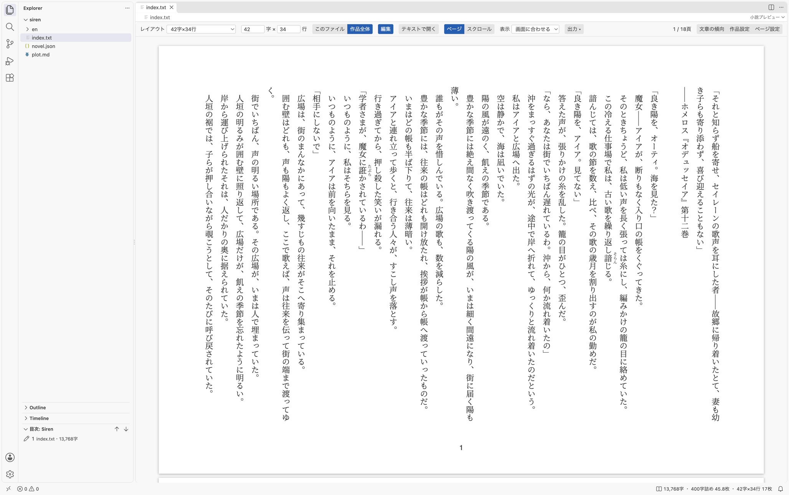
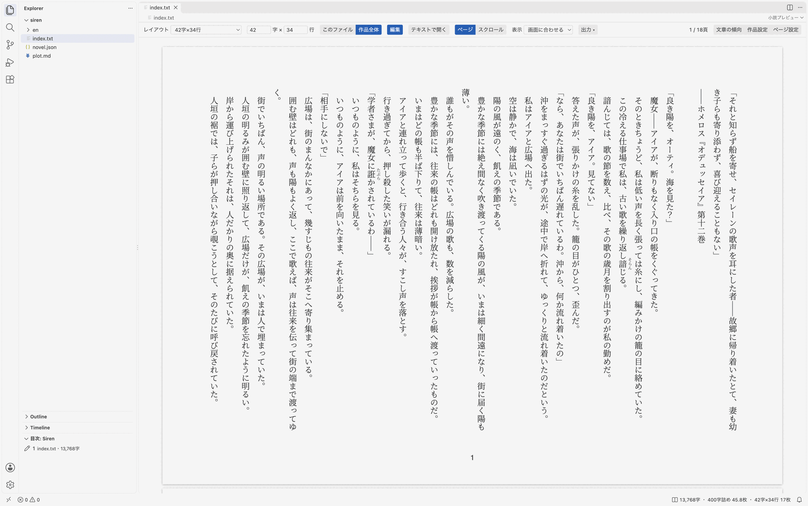
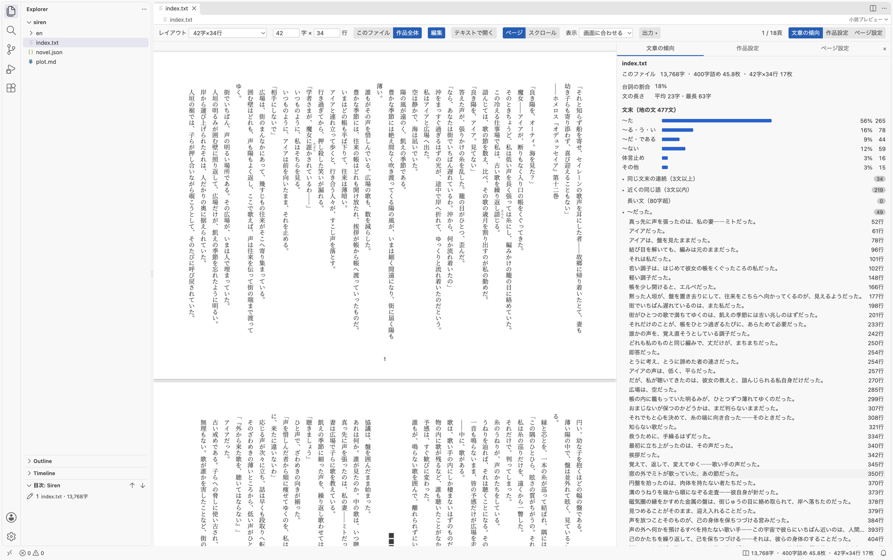

# Novel Preview

English | [日本語](README.ja.md)

A VS Code extension that shows a manuscript text file (`.txt`) as pages typeset the same way as the PDF you submit.

- **Typeset by characters × lines**: Set the paper, margins and characters × lines the way you set up a page in Word, and the manuscript is typeset on exactly those pages, vertically (or horizontally). Write while checking that it looks the same as what you submit in a contest's required format (for example, 42 characters × 34 lines)
- **Scroll view**: "Scroll" on the toolbar shows the text horizontally, flowing down without page breaks as on Kakuyomu or Shōsetsuka ni Narō (even for a vertical layout). "Page" goes back to the paper view
- **Edit in the preview**: Click a paragraph in the page view to edit it in place. What you type goes straight into the manuscript file
- **Same typesetting as the PDF**: The preview and the PDF export use the same parser and the same styles. The extension exports PDFs on its own
- **English manuscripts**: Manuscripts in English, such as translations, are detected automatically and typeset like a paperback (6×9in and others)
- **Manuscript paper counts**: The status bar and "Prose" in the novel panel show the character count, the count in sheets of 400-character manuscript paper, and the number of pages in the current layout (the panel also shows them for the whole work). The Explorer shows an outline by chapter with character counts
- **Reordering**: Drag chapters or files in "Novel Outline" in the Explorer, or right-click "Move Up" / "Move Down", and the numbers at the start of the file names are renumbered `010_`, `020_`… in that order (the rest of the name stays; files without a number get one). The part boundaries in `novel.json` (`"parts"`) follow the file that starts each part. Before renaming, the new file names are shown for you to confirm. "…" → "Renumber the File Names" in the outline's title bar renumbers without changing the order. File names of the English manuscript, and part boundaries when reordering the English outline, are not changed
- **Novel panel**: Tabs for "Prose", "Work" and "Page Setup" to the right of the preview. They are about the manuscript shown in the preview, and do not appear without a preview. Drag the border to change the width
- **Prose**: The "Prose" tab of the novel panel shows, for the open manuscript, the distribution of sentence endings in the narration (〜た, 〜る, 〜だ, 〜ない, noun endings), the share of dialogue, and sentence lengths. Click a run of the same ending, the same word repeated nearby (counted by base form: 3+ times within 3 sentences, or twice in one sentence; pronouns, proper nouns, katakana words not in the dictionary, and the names listed in `names` in `novel.json` are not counted), a long sentence, or a sentence with 「だった」 or 「ような」 to open its line. Sentence endings and words are determined by morphological analysis with Lindera and the IPA dictionary. The dictionary is not loaded until the tab is first shown (it then uses about 250 MB of memory). Turning off the setting `novelPreview.prose` stops the analysis (character counts are still shown). The analysis is for Japanese manuscripts

Ruby (`|漢字《かんじ》`) and emphasis dots (`《《強調》》`) are written the same way as on Kakuyomu and Shōsetsuka ni Narō. The main [Aozora Bunko annotations](https://www.aozora.gr.jp/annotation/) also work. Chapter headings (`【】`), scene breaks, the synopsis file and the rest of the notation, and how each output typesets them, are described in "[Manuscript notation](https://github.com/omni-stove/novel-kit/blob/main/vscode/docs/notation.md)" (in Japanese).

The extension's interface follows the display language of VS Code (English or Japanese).

## Installation

Search for "Novel Preview" in the Extensions view of VS Code and install it.

Chrome, which is used for PDF export, is downloaded the first time you export a PDF (about 180 MB). Nothing else needs installing.

## Usage

Right-click a `.txt` tab → "Reopen Editor With…" and choose "Novel Preview". To make it the default, write `"workbench.editorAssociations": { "*.txt": "novelPreview.editor" }` in `.vscode/settings.json` of the work's folder.

The layout is saved in the work's `novel.json`.

Click a paragraph in the page view to edit it in place. Notation such as ruby shows as written only while editing, and the paragraph is typeset again when you click outside it or press Esc.

## Novel panel

It appears to the right of the preview. "Prose & Settings" at the right end of the toolbar opens and closes it ("×" on the panel closes it too), and the tabs at the top of the panel switch between "Prose", "Work" and "Page Setup". The panel remembers whether it is open, the tab and the width, and the next preview you open starts the same way. The command "Open the Novel Panel" (Command Palette, or "…" in the title bar of a `.txt` tab) also opens it (with a preview to the side if there is none).

- **Prose** (the default tab): character counts and sheets for this file and the whole work, and the tendencies of the prose
- **Work**: the form for `novel.json` (see "Work settings" below)
- **Page Setup**: the layout (preset, characters × lines), writing direction, paper, margins and font, and saving and deleting presets

## Work settings

The "Work" tab of the novel panel edits the `novel.json` nearest to the manuscript. Changes are saved right away and take effect in the preview (if there is no `novel.json` yet, you can create one from the tab). When you open `novel.json` (also with the command "Open Work Settings", or by right-clicking `novel.json` in the Explorer), the same form opens as a page of its own. The form edits the work information such as the title and the author, the part boundaries, the outputs (`"outputs"`) and the fields of the English outputs, and the changes go straight into `novel.json`. To edit the JSON as it is, use "Open as Text".

- **Manuscript**: choose from the directory of `novel.json` and the directories under it that contain `.txt` files (the same for the work, the English outputs and each output)
- **Part boundaries**: turning on "Divide into parts" lists the manuscript files; check the files that start a new part (written to `"parts"`). Chapters are numbered "part-chapter" as in the PDF ("part" when a part has one chapter), and the preview and the outline use the same numbers. A work has one set of part boundaries, which applies to every output
- **Outputs**: each output shows its format and only the fields that apply to that format. pdf and rtf have a language (Japanese / English; English makes them pdf-en / rtf-en). "Build" makes just that output

## Outputs

"Build the Outputs of novel.json" (Command Palette, "…" in the editor title bar, or right-click `novel.json` in the Explorer) lets you choose from the outputs in `"outputs"` of `novel.json` and makes them. It does the same as `novel build`, and the settings of each output apply as they are. The formats are pdf / pdf-en / novel-pdf / epub / rtf / rtf-en / docx / split / merge.

- pdf asks for pages to extract (`--pages`) and the number of files to typeset from the start (`--limit`), split / merge ask for the target readers (`--target`), and merge asks whether to write ruby in parentheses (`--ruby-parens`)
- Outputs are written to the setting `novelPreview.outDir` (relative to the workspace folder; `out` by default)
- docx is a vertical Word document. The paper, margins and characters × lines of the layout go into Word's Page Setup, so the text fits the same grid when opened in Word. The cover and synopsis have no page numbers, and numbering starts on the first page of the body
- PDFs, RTFs and docx files are opened after export. Set `novelPreview.openAfterExport` to false, or the environment variable `AUTO_OPEN=0`, to not open them
- novel-pdf uses Ghostscript (`gs`), and epub uses `zip`

"Export a PDF in the Current Layout" writes a PDF to `out/preview/` in the layout you see in the preview, for checking.

"Export" on the preview toolbar lets you choose what to make from a menu: "PDF in the Current Layout" and the outputs in `"outputs"` of the `novel.json` nearest to the manuscript ("All Outputs" too, if there are two or more).

## Backup

"☁ Backup" on the preview toolbar (also the cloud button in the title bar of "Novel Outline" in the Explorer, and the command "Back Up to the Remote Repository") saves unsaved manuscripts, records every change in the work's folder with Git, and sends it to the remote repository such as GitHub. One click keeps a copy of the manuscript elsewhere, without knowing git commands.

- It works through the Git extension built into VS Code, which also asks you to sign in to GitHub
- If the work's folder is not a Git repository yet, it offers "Publish to GitHub"; if there is no remote, the Git extension's "Publish Branch"
- Each record is named automatically with the date and time it was made, like "2026-10-27 14:05". If Git has no name and email address, it asks for them the first time and sets them in that repository
- Backups made on another computer are fetched first, then sent. If the same place was changed on both and they conflict, it stops; resolve it in the Source Control view and press it again

## Showing and hiding

Buttons and displays you do not use can be hidden in the settings (search for `novelPreview.show` in Settings). All are on by default.

- `novelPreview.show.backup`: the backup button and command
- `novelPreview.show.statusBar`: the character count, sheets of manuscript paper and layout in the status bar
- `novelPreview.show.outline`: "Novel Outline" in the Explorer
- `novelPreview.show.editorButtons`: the buttons in the title bar of the editor of a `.txt` / `novel.json`

## Differences from the PDF

The preview approximates page breaks with Chromium's multi-column layout, so it can be off from the PDF by a few pages. Export a PDF to check before you submit.
